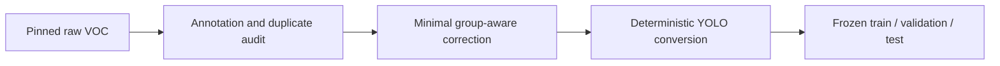
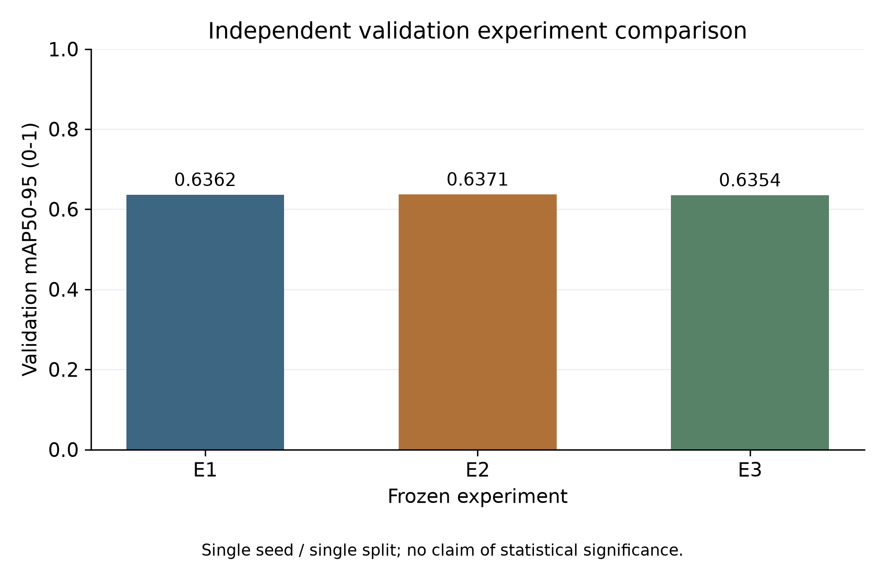
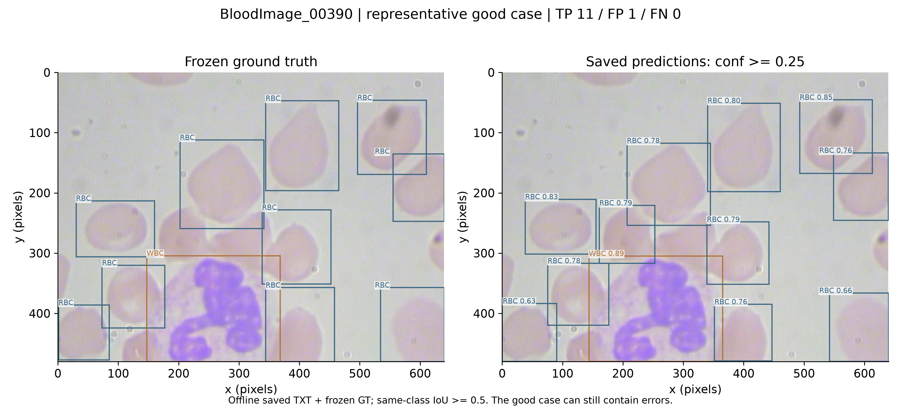
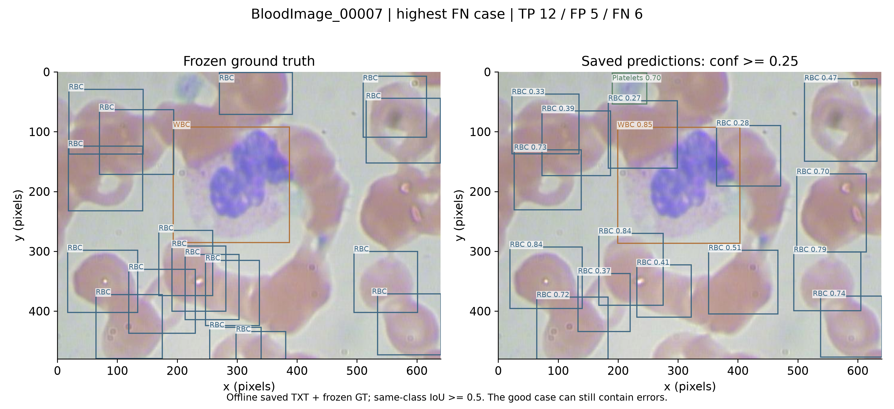
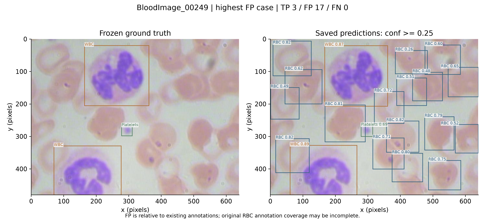

# YOLO26n Blood Cell Detection

A lightweight and reproducible object-detection pipeline for RBC, WBC and platelet detection on BCCD.

## Highlights

- Dataset quality auditing before training: annotation checks, an all-pairs near-duplicate scan and a minimal group-aware split correction.
- Controlled ablation experiments for class weighting and input resolution.
- Strict validation/test isolation with validation-based model selection and a one-time final test.
- Reproducible configurations, pinned sources, hashes and explicit data-loader guards.
- Accuracy–efficiency benchmarking with synchronized GPU timing and repeated warmed measurements.
- Lightweight Gradio demo for interactive RBC, WBC and Platelets detection.

## Final Test

| Precision | Recall | mAP50 | mAP50-95 |
| --- | --- | --- | --- |
| 82.76% | 90.49% | 91.56% | 61.76% |

The final model was selected using validation mAP50-95 before the test split was evaluated.
The test split was evaluated once after model selection was frozen, using the restored E2 checkpoint.
These metrics describe 72 BCCD test images, not clinical performance. Precision/recall use the Ultralytics max-F1 operating point; mAP integrates the precision–recall curve.

## Data quality

[BCCD](https://github.com/Shenggan/BCCD_Dataset) contains **364 images** and three classes: RBC, WBC and Platelets.
The audit found **2 zero-area annotations** and **one cross-split near-duplicate acquisition pair** across **66,066 image pairs**.
Raw annotations: **4,888 objects**. Modeling annotations: **4,886 objects**.
The corrected split is **206 train / 86 validation / 72 test**; test membership is unchanged.
Raw source data was not modified. See [dataset audit](docs/dataset_audit.md) and [methodology](docs/methodology.md).



## Experiments

| Experiment | Input | cls_pw | Purpose | Validation mAP50-95 |
| --- | --- | --- | --- | --- |
| E1 | 640 | 0.0 | Baseline | 0.636218 |
| E2 | 640 | 0.5 | Class weighting | 0.637143 |
| E3 | 512 | 0.5 | Resolution trade-off | 0.635402 |

**E2** won only by a small margin under the preregistered validation rule.
At `cls_pw=0.5`, overall AP50-95 increased slightly, RBC improved, WBC decreased slightly and Platelets were approximately unchanged/slightly lower.
Class weighting produced a limited, class-dependent trade-off; it did not consistently improve minority-class AP.



## Efficiency: 512 vs 640

Overall validation mAP50-95 changed by **-0.174 percentage points**.

| Metric | 640 (E2) | 512 (E3) | Change |
| --- | --- | --- | --- |
| avg train+val time (s/epoch) | 3.0852 | 2.6518 | -14.05% |
| training peak allocated VRAM (GiB) | 2.4760 | 1.6007 | -35.35% |
| training peak reserved VRAM (GiB) | 2.7422 | 1.7422 | -36.47% |
| median pipeline latency (ms/image) | 2.6759 | 2.3673 | -11.53% |
| median throughput (images/s) | 373.7086 | 422.4213 | +13.03% |

512 offers a strong efficiency gain with a small overall accuracy reduction, while Platelets were more resolution-sensitive in this experiment.
Timing used an RTX 4070 SUPER, batch 16, FP16, five fresh-process repeats per model, two complete warmup passes per worker and CUDA synchronization.
Pipeline latency includes loading, preprocessing, inference, postprocessing and result iteration; training resource values come from one historical run per configuration.
See [experiment design](docs/experiments.md) and [complete results](docs/results.md).

## Qualitative results

Existing predictions from the single final test pass were rendered offline. The selected cases include strengths and errors.

| Representative case | High false-negative case | High false-positive case |
| --- | --- | --- |
|  |  |  |

Errors are relative to existing annotations. Coverage gaps may contribute to apparent false positives; ground truth was left unchanged.

## Reproduce

Python **3.12.10**; the recorded environment uses PyTorch **2.10.0+cu128**, torchvision **0.25.0+cu128** and Ultralytics **8.4.175**.
Create a separate local environment; datasets and weights are fetched independently and stay untracked.

```powershell
python -m venv .venv
.\.venv\Scripts\python.exe -m pip install -r requirements.txt -c configs/environment_constraints.txt
.\.venv\Scripts\python.exe -m pip check
# Read-only evidence verification: no model loading or data download
.\.venv\Scripts\python.exe scripts/render_results.py --verify
# Optional data reproduction: fixed source, complete scan, deterministic conversion
.\.venv\Scripts\python.exe scripts/fetch_dataset.py
.\.venv\Scripts\python.exe scripts/audit_dataset.py
.\.venv\Scripts\python.exe scripts/find_near_duplicates.py
.\.venv\Scripts\python.exe scripts/prepare_dataset.py
```

Open [project_walkthrough.ipynb](notebooks/project_walkthrough.ipynb) for a model-free tour (`RUN_TRAINING=False`).
Explicit new training and benchmark commands are in [experiments](docs/experiments.md).
New reproduction outputs are separated from immutable published evidence. No automatic final-test rerun entry is distributed.

## Interactive Demo

The local Gradio demo illustrates detection on one uploaded JPG/JPEG/PNG microscopy image.
Drag or upload an image, view the original, adjust **Confidence threshold** (0.05–0.95, default 0.25), then select **Detect**.
The output shows bounding boxes, RBC/WBC/Platelets counts, total detections, local inference time in milliseconds and CPU/CUDA device.
**Clear** restores the initial form. Zero detections returns zero counts normally.

Install into this repository's own `.venv` after the environment setup above:

```powershell
.\.venv\Scripts\python.exe -m pip install -r requirements-app.txt
.\.venv\Scripts\python.exe app\app.py
```

Provide the original validation-selected **E2 best.pt** separately; weights are not included in Git.
The default location is `outputs/experiments/e2_class_weight_640/weights/best.pt`, matching the original frozen run.
Weight resolution is `--weights` → `BLOOD_CELL_WEIGHTS` → the default path. Relative paths resolve from this repository root.
For a checkpoint stored elsewhere:

```powershell
.\.venv\Scripts\python.exe app\app.py --weights "path\to\best.pt"
# Alternative: set a process-scoped path before launching
$env:BLOOD_CELL_WEIGHTS = "path\to\best.pt"
.\.venv\Scripts\python.exe -m app.app
```

Open the localhost URL printed in the terminal (normally `http://127.0.0.1:7860`).
The app verifies the checkpoint SHA-256 against frozen evidence and checks `0: RBC`, `1: WBC`, `2: Platelets`.
It uses `imgsz=640`, loads the model lazily on first Detect, and reuses it for subsequent requests.
CUDA is selected when available; otherwise inference uses CPU. Missing weights produce a concise error; nothing is downloaded or trained automatically.
Fresh reproduction checkpoints are not substituted for the frozen E2 model.

The displayed time includes server-side image decoding, first-use model loading, prediction and box drawing;
it excludes browser upload/display and queue waiting. It is a per-request demo measurement, not the published efficiency benchmark.
Uploads and rendered images may remain temporarily in ignored `.cache/gradio/`; the demo listens on localhost with public sharing disabled.
This app does not train models, evaluate a dataset split, rerun the final test or modify published evidence.

**Research / educational demonstration only. Not for clinical diagnosis, medical decision-making, or treatment.**

To check error handling and UI wiring without model inference:

```powershell
.\.venv\Scripts\python.exe -m unittest discover -s tests -v
```

## Limitations

Small dataset, one seed, one corrected split, limited minority-class samples, unavailable patient/slide metadata, annotation coverage uncertainty and a 72-image test set.
No clinical validation; efficiency depends on hardware and the timing protocol. Read [limitations](docs/limitations.md).

Data and model attribution: [third-party notices](THIRD_PARTY_NOTICES.md).
