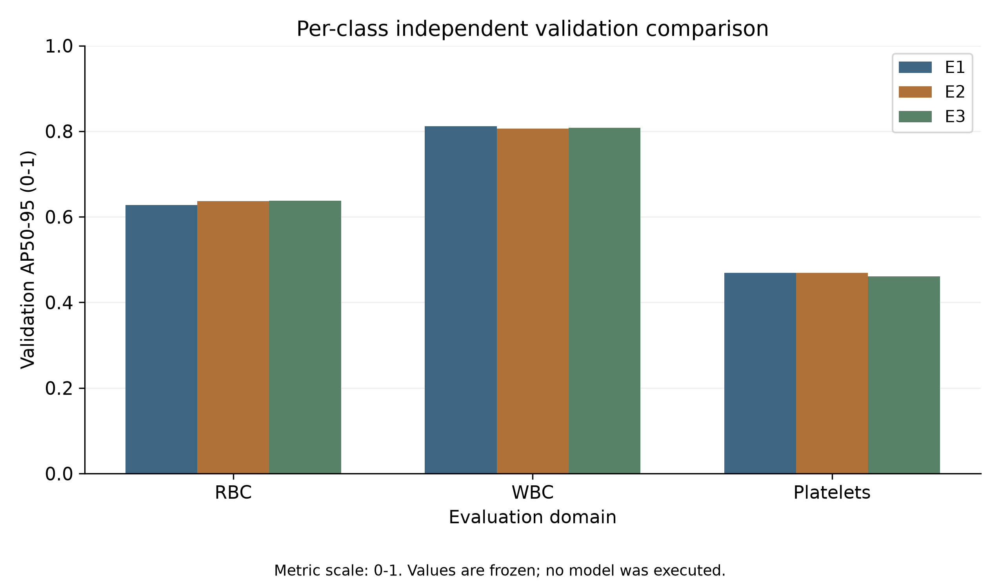
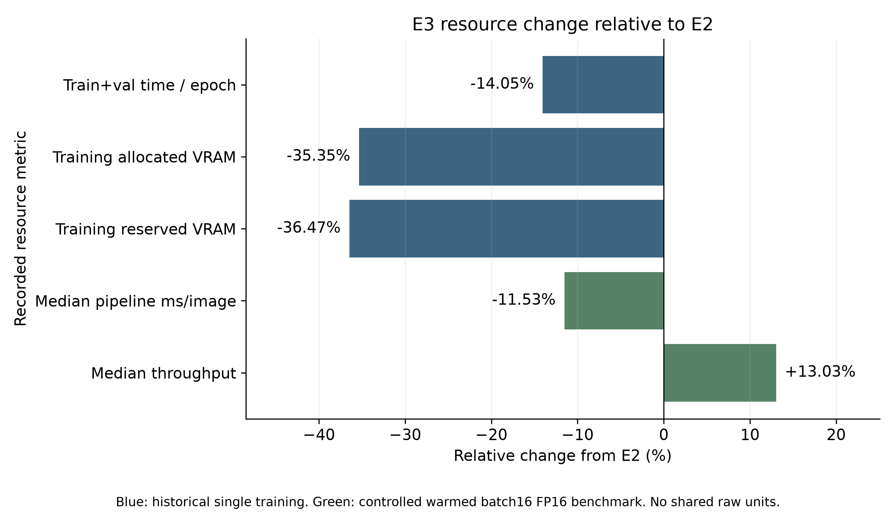
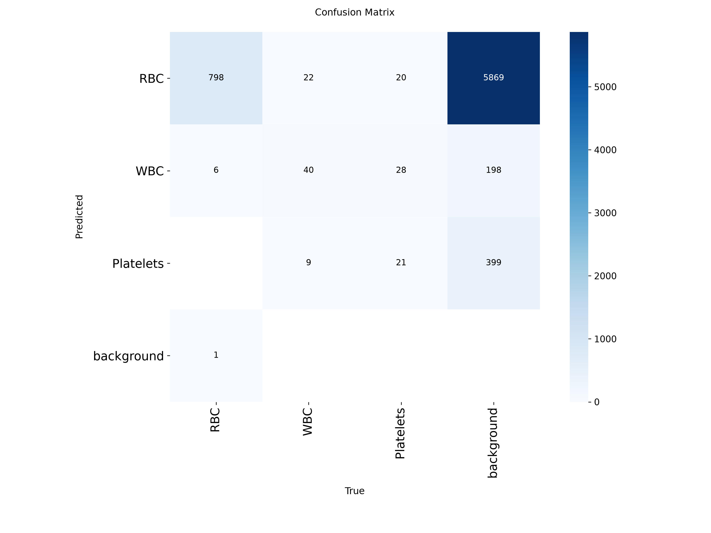

# Frozen results

All tables are generated by `scripts/render_results.py` from `docs/evidence/frozen_results.json`.
The evidence manifest records hashes of public extracts, figures and their original measured input artifacts. Figure pixels and encoded image data are unchanged; ancillary text metadata was removed for publication.
No training, validation or prediction is performed while rendering these documents.

## Validation

| Experiment | Precision | Recall | mAP50 | mAP50-95 |
| --- | --- | --- | --- | --- |
| E1 | 0.825267 | 0.914447 | 0.919868 | 0.636218 |
| E2 | 0.863390 | 0.898984 | 0.912741 | 0.637143 |
| E3 | 0.863857 | 0.873104 | 0.918488 | 0.635402 |

E2 was selected before test evaluation. Differences are small and do not imply statistical significance.

## Per-class AP50-95

| Class | E1 validation AP50-95 | E2 validation AP50-95 | E3 validation AP50-95 | E2 test AP50-95 |
| --- | --- | --- | --- | --- |
| RBC | 0.627479 | 0.636297 | 0.637593 | 0.621521 |
| WBC | 0.812071 | 0.806405 | 0.807826 | 0.773021 |
| Platelets | 0.469104 | 0.468728 | 0.460786 | 0.458303 |

## Final test: selected E2

| Precision | Recall | mAP50 | mAP50-95 |
| --- | --- | --- | --- |
| 82.76% | 90.49% | 91.56% | 61.76% |

72 images / 945 labeled objects. Exactly one model test evaluation after checkpoint restoration and selection freeze.
P/R use Ultralytics max-F1; AP is curve-integrated. Metrics are relative to the fixed BCCD labels.

## Validation–test gap

| Metric | Test minus E2 validation (percentage points) |
| --- | --- |
| Precision | -3.5832 |
| Recall | +0.5952 |
| mAP50 | +0.2826 |
| mAP50-95 | -1.9529 |

The AP50-95 gap is descriptive. One split cannot establish or rule out overfitting or patient-level generalization.

## Efficiency

| Metric | 640 (E2) | 512 (E3) | Change |
| --- | --- | --- | --- |
| avg train+val time (s/epoch) | 3.0852 | 2.6518 | -14.05% |
| training peak allocated VRAM (GiB) | 2.4760 | 1.6007 | -35.35% |
| training peak reserved VRAM (GiB) | 2.7422 | 1.7422 | -36.47% |
| median pipeline latency (ms/image) | 2.6759 | 2.3673 | -11.53% |
| median throughput (images/s) | 373.7086 | 422.4213 | +13.03% |

Historical training resource measurements are distinct from five-repeat synchronized warmed batch-16 FP16 pipeline timing.
The latter includes loading/iteration and excludes model load/warmup; it is hardware dependent.

## Error analysis

| Class | TP | FP | FN |
| --- | --- | --- | --- |
| Overall | 876 | 440 | 69 |
| RBC | 741 | 411 | 64 |
| WBC | 71 | 8 | 0 |
| Platelets | 64 | 21 | 5 |

Offline matching uses confidence ≥0.25, same-class IoU ≥0.5 and descending-IoU greedy one-to-one matching.
These counts differ from max-F1 P/R and the native confusion matrix operating point.
RBC dominates absolute FP/FN counts; this does not normalize for class prevalence.

The original matrix uses confidence 0.001 / matching IoU 0.45; rows are predicted classes and columns are ground truth.
Frozen illustrative cases: `BloodImage_00390` (TP11/FP1/FN0), `BloodImage_00007` (TP12/FP5/FN6), `BloodImage_00249` (TP3/FP17/FN0).
The last image has no RBC labels, although predictions contain RBC-like objects. Missing annotation coverage is possible; appearance is not medical ground truth, and labels were not changed.
